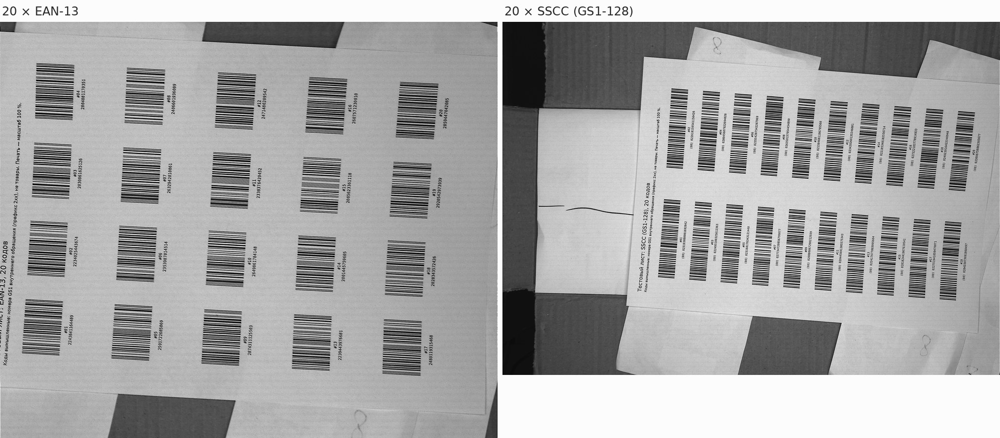
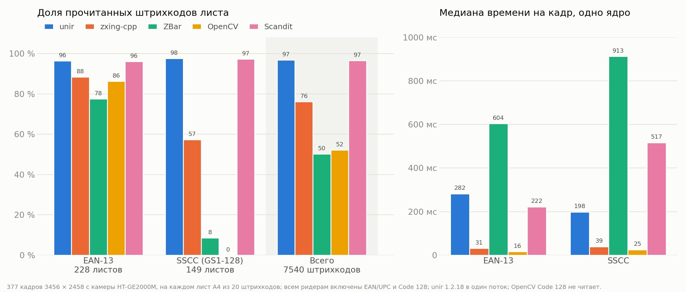

# Sheets of 20 barcodes from an industrial camera

Addendum 2 to the [Habr article](https://habr.com/ru/articles/1107274/) (in Russian): many barcodes in one frame,
as on a sheet of labels, a box or a pallet.



## Frames

Two A4 sheets of 20 barcodes each: EAN-13 (4 rows of 5) and SSCC — GS1-128 with AI (00) (2 rows of 10),
[sheets/](sheets) (PDF for printing at 100 %, PNG, truth). The numbers are made up, GS1 prefix 2xx (in-store range,
not assigned to any product). The sheets were moved by hand under an HT-GE2000M industrial camera: 3456 × 2458
(8.5 MP), monochrome; the sheet is rotated, the exposure is dark, part of the frames has motion blur, sometimes the
sheet goes past the edge of the frame. 377 frames: 228 with the EAN-13 sheet and 149 with the SSCC sheet,
7540 barcodes. List — [frames.lst](frames.lst).

**The frames themselves (PNG, 0.97 GB) — in the
[sheets-v1 release](https://github.com/libscanner/barcode-1d-benchmark/releases/tag/sheets-v1).**
Check: `sha256sum -c SHA256SUMS.txt`. Licence of the frames and sheets: CC BY 4.0 (ours).

Truth: one sheet per frame, the codes of the two sheets do not overlap, there are no other barcodes in the frame.
A code of that sheet is correct; any other number is a false read.

## Readers and settings

All readers get the same symbologies — EAN-13/UPC-A, EAN-8, UPC-E and Code 128 — and are not told which sheet is
in the frame ([multi_bench.py](multi_bench.py)):

- unir 1.2.18 (`pip install libscanner-unir==1.2.18`): `Settings.multi(64)`, budget 4 s, one thread
  (and 4 threads for reference); from the command line —
  `unir --batch <list> --sym ean,128,gs1 --codes 64 --budget-ms 4000 --threads 1`;
- Scandit Barcode Scanner SDK 8.7.1 for Linux: high effort preset, no location or direction hints, up to 64
  locations per frame, multi-scan, inverted codes (trial licence; the binding is not included);
- zxing-cpp 3.1.1: two binarizers, rotate, downscale, invert;
- ZBar 0.23.93 (pyzbar): the frame, inverted, rotated by 45°;
- OpenCV 5.1: `cv2.barcode.BarcodeDetector` without a model (does not read Code 128).

The frame is decoded to grayscale in memory beforehand; the time is the read call only. Every reader runs in its own
process pinned to one core (WSL, Intel Core i5-1335U).

## Results



| reader | read of 7540 | EAN-13 (4560) | SSCC (2980) | whole sheets (of 377) | false | median / p90, ms |
|---|---:|---:|---:|---:|---:|---|
| unir 1.2.18 | **7305 (96.9 %)** | **4396** | **2909** | **342** | **0** | 267 / 529 |
| Scandit 8.7.1 | 7277 (96.5 %) | 4379 | 2898 | 327 | **0** | 285 / 744 |
| zxing-cpp 3.1.1 | 5738 (76.1 %) | 4032 | 1706 | 180 | 2 | 33 / 44 |
| OpenCV 5.1 | 3936 (52.2 %) | 3936 | 0 | 123 | 490 | **17 / 27** |
| ZBar 0.23.93 | 3790 (50.3 %) | 3537 | 253 | 3 | 972 | 658 / 1017 |

unir in 4 threads: the same answers on every frame, 172 / 304 ms. Read by any reader: 7355, by none: 185.
Full summary — [results/summary.md](results/summary.md); every reader's answer and time per frame —
`results/<reader>.tsv` (frame, ms, texts separated by `\x1f`, CPU ms).

## Repeat

```
unzip barcode-sheets-frames-v1.zip -d sheets-v1
bash run_all.sh sheets-v1/frames      # Linux / WSL; writes results/*.tsv and results/summary.md
```
